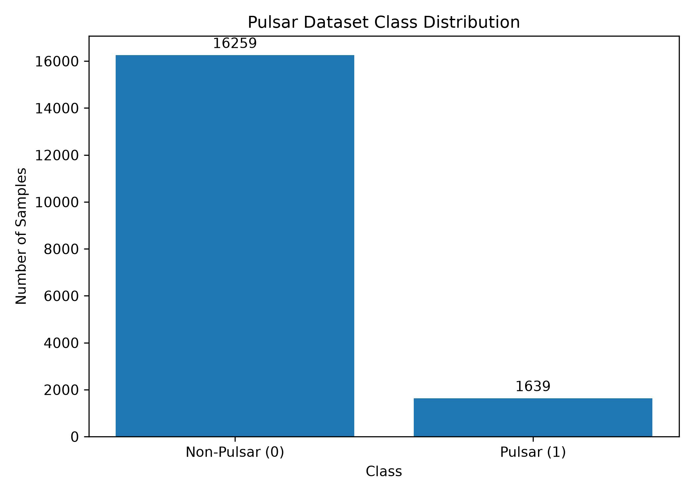
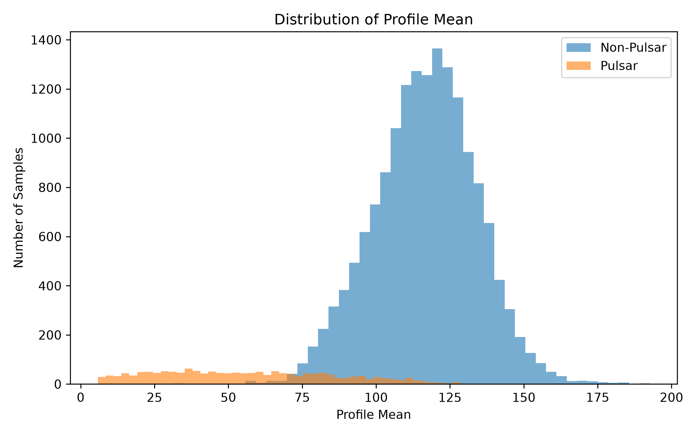
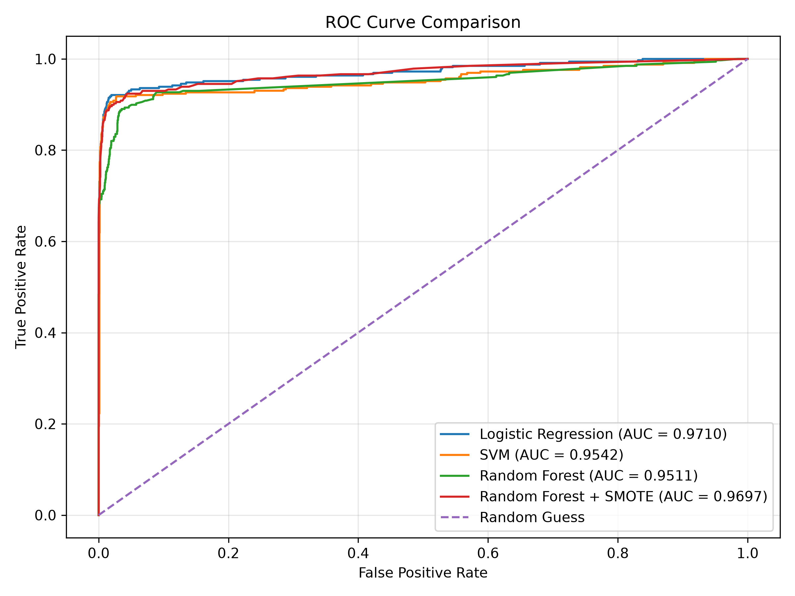

# Pulsar Signal Classification using Machine Learning

Classifying radio-telescope signal candidates as **pulsars** or **non-pulsars** with Logistic Regression, SVM and Random Forest (with and without SMOTE), using the HTRU2 dataset.


---

## Table of Contents

1. [Overview](#overview)
2. [Dataset](#dataset)
3. [Methodology](#methodology)
4. [Project Structure](#project-structure)
5. [Code Structure](#code-structure)
6. [Setup and Installation](#setup-and-installation)
7. [Running the Project](#running-the-project)
8. [Results](#results)
9. [Known Issues and Possible Improvements](#known-issues-and-possible-improvements)
10. [References](#references)
11. [Authors](#authors)

---

## Overview

Pulsars are rapidly rotating neutron stars that emit periodic radio signals. Radio surveys produce huge numbers of candidate signals, and the vast majority are radio-frequency interference or noise. Checking them by hand is slow, so this project treats it as a **binary classification** problem on statistical features extracted from each candidate.

Because pulsars make up only about 9% of the data, the project also looks at how **class imbalance** affects each model, and why recall, precision and F1 matter more than accuracy alone here.

A short write-up is available in [`REPORT.pdf`](REPORT.pdf).

---

## Dataset

**HTRU2** (High Time Resolution Universe Survey, South), stored at `data/HTRU_2.csv`.

| Property | Value |
|---|---|
| Samples | 17,898 |
| Input features | 8 (all numeric) |
| Target | `target` (0 = non-pulsar, 1 = pulsar) |
| Non-pulsars (0) | 16,259 (about 90.8%) |
| Pulsars (1) | 1,639 (about 9.2%) |
| Missing values | None |

**Features.** Four statistics are computed from the integrated pulse profile, and the same four from the DM-SNR curve:

| Group | Columns |
|---|---|
| Integrated pulse profile | `profile_mean`, `profile_std`, `profile_kurtosis`, `profile_skewness` |
| DM-SNR curve | `dm_snr_mean`, `dm_snr_std`, `dm_snr_kurtosis`, `dm_snr_skewness` |

<p align="center">
  
  
</p>

*Left: the strong class imbalance. Right: `profile_mean` separates the two classes noticeably, with pulsars shifted towards higher values.*

---

## Methodology

1. **Load and inspect** the data: shape, first rows and class counts.
2. **Split** into train and test sets, 80/20, using `stratify=y` so both sets keep the same class ratio (`random_state=42`).
   Result: 14,318 training rows and 3,580 test rows.
3. **Scale** features with `StandardScaler`. The scaler is fit on the training set only and then applied to the test set, which avoids data leakage.
4. **Train four configurations:**

   | Model | Details |
   |---|---|
   | Logistic Regression | Baseline. `max_iter=1000`, trained on scaled data. |
   | SVM | RBF kernel, default hyperparameters, trained on scaled data. |
   | Random Forest | `n_estimators=200`, `max_depth=110`, `min_samples_split=5`, `max_features=4`. Trained on **unscaled** data (tree models don't need scaling). |
   | Random Forest + SMOTE | `n_estimators=200`, otherwise default. Trained on SMOTE-balanced **scaled** training data. |

5. **Handle class imbalance with SMOTE.** It oversamples the minority class with synthetic points, taking the training set from 13,007 / 1,311 (non-pulsar / pulsar) to 13,007 / 13,007. SMOTE is applied to the training data only. The test set stays untouched, so evaluation reflects the real class distribution.
6. **Evaluate** on the held-out test set using accuracy, precision, recall, F1, confusion matrices and ROC-AUC.
7. **Visualise** class distribution, `profile_mean` by class, and ROC curves for all models.

---

## Project Structure

```text
Initial-Pulsar-Classification-/
├── data/
│   └── HTRU_2.csv                    # HTRU2 dataset (17,898 rows)
├── data_analysis.py                  # Full pipeline: load, preprocess, train, evaluate, plot
├── requirements.txt                  # Python dependencies
├── REPORT.pdf                        # Short project report
├── class_distribution.png            # Output: class counts bar chart
├── profile_mean_distribution.png     # Output: profile_mean histogram by class
├── roc_curve_comparison.png          # Output: ROC curves for all models
├── .gitignore
└── README.md
```

## Code Structure

Everything lives in a single script, `data_analysis.py`, which runs top to bottom in these sections:

| Section | What it does |
|---|---|
| Data loading | Reads `data/HTRU_2.csv`, prints shape, head and class counts, and separates `X` and `y` |
| Train/test split | Stratified 80/20 split |
| Scaling | `StandardScaler` fit on train, applied to train and test |
| Logistic Regression | Trains, predicts, and prints metrics and confusion matrix |
| SVM (RBF) | Same flow as above |
| Random Forest | Same flow, on unscaled features |
| Model comparison | Prints a comparison table for the first three models |
| SMOTE | Prints class counts before and after, and resamples the scaled training set |
| Random Forest + SMOTE | Trains on resampled data and evaluates on the original test set |
| Final comparison | Prints the four-model table |
| Visualisation 1 and 2 | Saves `class_distribution.png` and `profile_mean_distribution.png` |
| Visualisation 3 | Computes probabilities and AUC for all models and saves `roc_curve_comparison.png` |

---

## Setup and Installation

**Prerequisites:** Python 3.9 or newer and `pip`. The project was verified on Python 3.12.

**1. Clone the repository**

```bash
git clone https://github.com/Janavi88/Initial-Pulsar-Classification-.git
cd Initial-Pulsar-Classification-
```

**2. Create a virtual environment**

```bash
python -m venv venv
```

**3. Activate it**

| OS | Command |
|---|---|
| Windows (cmd / PowerShell) | `venv\Scripts\activate` |
| macOS / Linux | `source venv/bin/activate` |

**4. Install dependencies**

```bash
pip install -r requirements.txt
```

Dependencies: `pandas`, `numpy`, `scikit-learn`, `matplotlib`, `imbalanced-learn`.

---

## Running the Project

Run from the repository root, since the script reads `data/HTRU_2.csv` by relative path:

```bash
python data_analysis.py
```

What to expect:

- Metrics, confusion matrices and comparison tables are printed to the console.
- Three plots are saved to the repository root (`class_distribution.png`, `profile_mean_distribution.png`, `roc_curve_comparison.png`). The script also calls `plt.show()`, so each plot opens in a window, and the script continues after you close it.
- On a headless machine or server, run it without display windows:

  ```bash
  MPLBACKEND=Agg python data_analysis.py
  ```

All models use fixed random seeds (`random_state=42`), so results should be reproducible on the same library versions.

---

## Results

Evaluated on the held-out test set of 3,580 samples (3,252 non-pulsars and 328 pulsars).

### Classification metrics

| Model | Accuracy | Precision | Recall | F1-score |
|---|---|---|---|---|
| Logistic Regression | 97.96% | 94.43% | 82.62% | 88.13% |
| SVM (RBF) | **98.07%** | **94.81%** | 83.54% | **88.82%** |
| Random Forest | 98.02% | 91.86% | 85.98% | **88.82%** |
| Random Forest + SMOTE | 97.46% | 83.95% | **89.33%** | 86.56% |

### Confusion matrices

Rows are the actual class and columns the predicted class, in the order `[[TN, FP], [FN, TP]]`.

| Model | TN | FP | FN | TP |
|---|---|---|---|---|
| Logistic Regression | 3236 | 16 | 57 | 271 |
| SVM (RBF) | 3237 | 15 | 54 | 274 |
| Random Forest | 3227 | 25 | 46 | 282 |
| Random Forest + SMOTE | 3196 | 56 | 35 | 293 |

### ROC curves



AUC values shown in the committed plot: Logistic Regression 0.9710, SVM 0.9542, Random Forest 0.9511, Random Forest + SMOTE 0.9697. See the note on the Random Forest AUC under [Known Issues](#known-issues-and-possible-improvements).

### Key takeaways

- All four configurations exceed **97% accuracy**, but with a 9% pulsar rate, a model that always predicts "non-pulsar" would already score about 91%. Accuracy alone is not informative here.
- **SVM** has the best accuracy, precision and (tied) F1.
- **Random Forest + SMOTE** has the best **recall (89.33%)**. It misses only 35 of 328 pulsars, compared with 54 for SVM and 57 for Logistic Regression.
- That recall gain costs precision (83.95%) and adds false positives (56 versus 15 for SVM). This is the core trade-off: SMOTE helps when missing a real pulsar is the more expensive mistake, while the other models suit cases where false alarms are costly.

---

## Known Issues and Possible Improvements

**Known issue: Random Forest ROC curve uses mis-scaled input.**
In `data_analysis.py`, the plain Random Forest is trained on *unscaled* `X_train`, but the ROC section computes its probabilities from the *scaled* test set:

```python
rf_prob = random_forest_model.predict_proba(X_test_scaled)[:, 1]   # current
```

This feeds the model data on a different scale from what it was trained on, which understates its AUC. The classification metrics above are not affected, since they use `X_test`. Changing the line to the following fixes it:

```python
rf_prob = random_forest_model.predict_proba(X_test)[:, 1]          # fix
```

Running this check separately gives a Random Forest AUC of about **0.966** instead of the 0.9511 shown in the committed plot. That would put it level with Random Forest + SMOTE and above SVM, so after applying the fix, re-run the script to regenerate `roc_curve_comparison.png`.

**Other limitations and ideas**

- The SVM ROC curve uses a separate `SVC(probability=True)` instance, because the default SVM does not output probabilities. Its AUC therefore comes from a slightly different model than the one in the metrics table.
- Evaluation uses a single train/test split. Stratified k-fold cross-validation would give more reliable estimates.
- Hyperparameters (especially for SVM and Random Forest) were not systematically tuned. A `GridSearchCV` or `RandomizedSearchCV` would be a natural next step.
- Only recall, precision and F1 at the default 0.5 threshold are reported. Precision-recall curves and threshold tuning suit imbalanced data well.
- Other options to try: class weights (`class_weight="balanced"`) as an alternative to SMOTE, gradient boosting (XGBoost / LightGBM), and splitting the code into modules (`preprocess.py`, `train.py`, `evaluate.py`).
- The current task is binary. Identifying specific pulsar types would need additional data.

---

## References

- R. J. Lyon, B. W. Stappers, S. Cooper, J. M. Brooke, J. D. Knowles, *Fifty Years of Pulsar Candidate Selection: From simple filters to a new principled real-time classification approach*, MNRAS 459 (1), 2016.
- HTRU2 dataset, UCI Machine Learning Repository.
- N. V. Chawla et al., *SMOTE: Synthetic Minority Over-sampling Technique*, JAIR 16, 2002.

---
